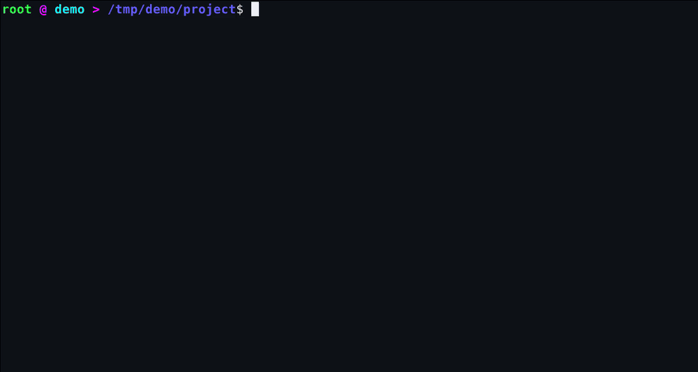
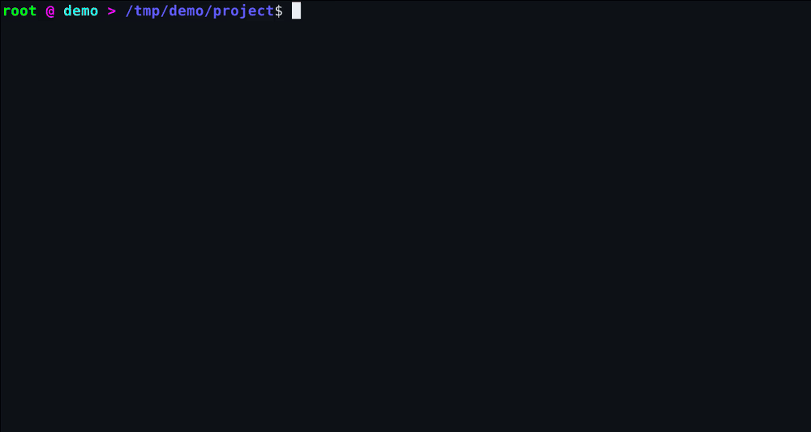

# 42sh

A Unix shell written in C, modelled on tcsh: it reads a command line, splits it into commands, starts the matching processes, connects them and keeps track of them.



**C · Unix system calls (fork, exec, pipe, dup2, wait, signals) · Make · Criterion**

Epitech project, team of 5.

## Features

- Pipes (`|`) and command separators (`;`).
- Redirections to and from files (`>`, `>>`, `<`).
- Job control: background jobs with `&`, suspending the foreground job with `Ctrl+Z`, and the `jobs`, `fg`, `bg` built-ins.
- Built-ins: `cd`, `env`, `setenv`, `unsetenv`, `alias`, `history`, `which`, `where`, `repeat`, `exit` and more; `help` lists them all.
- Line editing with history on the arrow keys, tab completion and aliases.
- A coloured prompt showing the user, the host, the directory and the exit status of the last command when it failed.



## Build & run

Requires `gcc` and `make`.

```sh
make            # builds ./42sh and its small libraries
./42sh
make tests_run  # unit tests and the shell tester
make fclean     # remove objects, libraries and the binary
```

## Project layout

- `main.c` - entry point.
- `src/parser/` - line editing, history navigation and splitting a line into commands.
- `src/tasker/`, `src/pipes/` - turning commands into tasks, pipes and redirections.
- `src/exec/` - starting processes and waiting for them.
- `src/built_in/` - one folder per built-in, including `jobs`, `fg` and `bg`.
- `src/history/`, `src/alias/` - history and aliases.
- `lib/` - small C libraries written for the project (strings, files, arguments).
- `tests/` - unit tests and a shell tester that compares the output with tcsh.

The C code follows the [Epitech coding style](https://github.com/Epitech/coding-style-checker).

## Team and contributions

Valentin Portefaix, Liam Colle, Kevin Huynh ([@Nivek-Hyn](https://github.com/Nivek-Hyn)), Hatim Ouaadi and Hugo Sorgues.

- Kevin Huynh: job control (background jobs with `&`, the `jobs`, `fg` and `bg` built-ins, suspending a program with `Ctrl+Z`, killing jobs).
